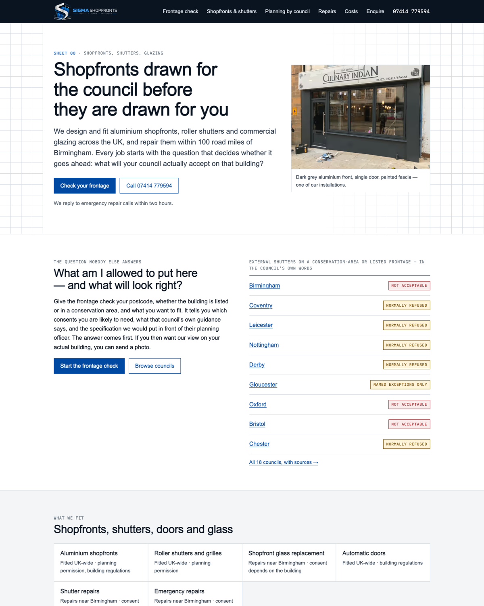
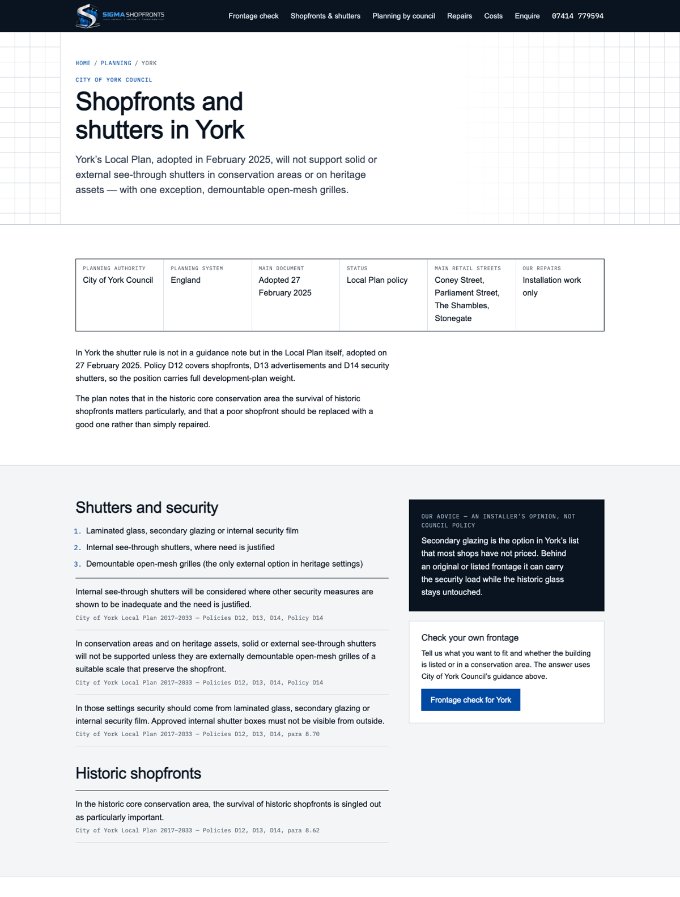
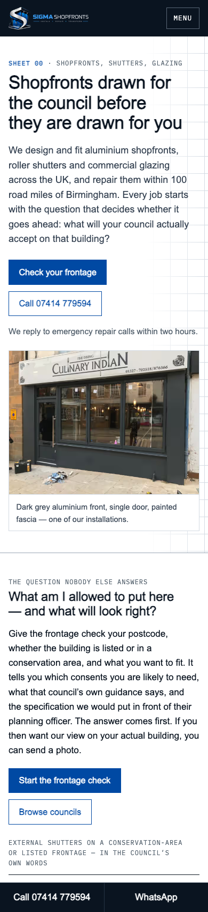

# Design direction: the drawing sheet

## The decision, in one paragraph

Sigma is asking to be trusted with listed buildings and conservation-area streets, so the site looks like the
document a planning officer actually reads: a measured drawing. Cool drawing-paper white, near-black ink, thin
rules, monospaced sheet labels and a title block, with one accent colour. That accent is not chosen — it is the
cobalt **#0049A3** sampled from the wordmark in `sigma-logo-light-bg.png`, and the ink **#0A1420** is the logo’s own
near-black, so the logo sits in the palette rather than against it. The logo files are untouched (pinned by hash).
The header and footer are a dark ink band because the horizontal logo was drawn for a dark ground; using it there
means no recolouring, cropping or redrawing. Light, precise and architectural suits the planning positioning better
than the old dark cyan/violet, and it is clear of every other site in the registry: dark-with-gold, light cream
with gold, warm paper with bottle green and brick red, and British enamel signage navy and red.

## Palette

| Token | Value | Use |
|---|---|---|
| paper | `#F3F5F7` | page ground |
| sheet | `#FFFFFF` | panels, the drawing grid |
| ink | `#0A1420` | text, header/footer band — the logo’s near-black |
| cobalt | `#0049A3` | links, actions — the logo’s wordmark blue |
| rule | `#D3DAE2` / `#9AA6B4` | hairlines, dimension lines |
| refuse / caution | `#A3161B` / `#744800` on washes | verdict badges only |

## Type

Archivo (display), IBM Plex Sans (text), IBM Plex Mono (sheet labels, references, figures). None is used by any
other site in the registry. Self-hosted under the OFL (`app/fonts/`), loaded with `display: optional` and
metric-adjusted fallbacks, so text never re-renders late.

## Motifs

- **Sheet labels** in mono capitals (`SHEET 02 · PLANNING BY COUNCIL`) above each heading.
- **Title block** on council pages: authority, planning system, document date, status, retail streets, repair cover.
- **Drawing grid** behind the page head.
- **Verdict badges** (“Not acceptable”, “Normally refused”, “Named exceptions only”) taken from each council’s own wording.
- **Citations** in mono under every council point: document, paragraph.
- A labelled **front elevation** on `/shopfront-anatomy`.

Phone width (390 px), all 85 pages checked for horizontal overflow — none:

